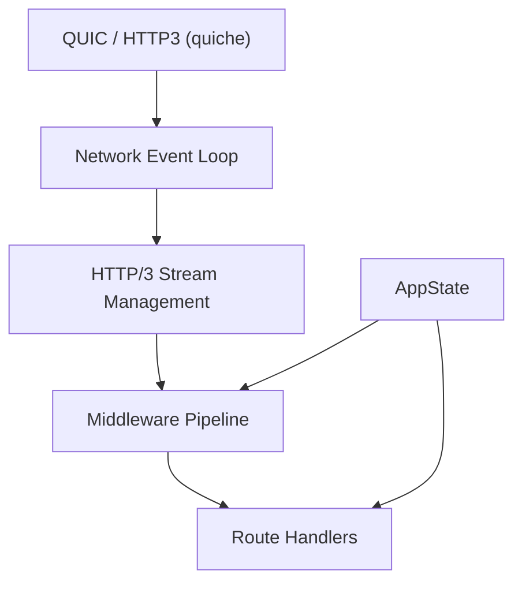
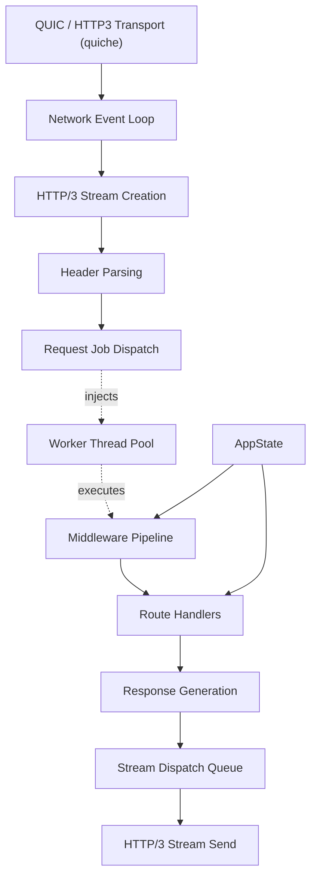

# FacesHttp3Server

Experimental HTTP/3 server framework written in Rust on top of the **QUIC implementation provided by quiche**.

The goal of this crate is to provide a lightweight abstraction layer over QUIC and HTTP/3 in order to simplify the implementation of networking applications while keeping control over the underlying transport behavior.

⚠️ This project was developed as part of an exploratory learning process and is **not intended for production use**.

---
  
# Project Context

`FacesHttp3Server` was developed in the context of a broader experimental application project exploring distributed multimedia systems and modern networking architectures.

The server framework was progressively designed while building the backend of this application. This allowed the framework to evolve through real usage scenarios and to be continuously tested by the application itself.

This approach allowed architectural decisions to emerge from concrete needs encountered during development.

---

# Main Features

- HTTP/3 server built on top of **QUIC (quiche)**
- event-driven network architecture
- modular routing system
- middleware processing pipeline
- configurable request body management
- channel-based communication between subsystems
- application state injection via a generic `AppState`

The framework focuses on **separating networking infrastructure from application logic**.

---

# Architecture Overview


This layered structure allows the networking layer to remain independent from domain-specific application logic.

# Request Lifecycle

A request handled by the server follows the processing pipeline below.


Each request is first received through the QUIC transport layer and dispatched by the network event loop.
It then goes through the middleware pipeline where headers can be inspected or modified.

Once the middleware stage is completed, the request is passed to the route handlers associated with the requested path.
The response generated by the final handler is then sent back to the client through the corresponding HTTP/3 stream.

---

# Application State Model

The framework does not impose any persistence model or domain structure.

Instead, application-specific logic is injected through a user-defined `AppState` type when creating the router. This allows developers to integrate their own storage systems or application logic without modifying the server infrastructure.

This application state is represented by the generic parameter `S` and must statisfied the following trait bounds: 

`Send + Sync + 'static `

Example:

```rust
// Application state must be Send + Sync
#[derive(Clone)]
pub struct AppState {
    pub database: DatabasePool,
}

let router = RouteManager::new_with_app_state(AppState { database });
```

The state instance is then accessible inside middleware and route handlers:

```rust
router.handler(&|event, app_state, previous_response| {
    // access application state or storage
});
```
This design allows the framework to remain independent from the application domain while enabling flexible integration with different persistence strategies.

# Quick Start
## Create the router with application state

```rust
// Application state must be Send + Sync
#[derive(Clone)]
pub struct AppStateTest;

let mut router = RouteManager::new_with_app_state(AppStateTest);
```

## Instantiate the server
Attach the router and the configuration paths.
As the server relies on QUIC protocol, valid TLS certificates are required.
```rust
let _server = Http3Server::new(ip_addr)
    .add_key_path("./key.pem")
    .add_cert_path("./cert.pem")
    .set_file_storage_path("~/.temp_server/")
    .run_blocking(router);
```
## Middleware

Middlewares allow inspection or modification of request headers before the request is processed by handlers.

``` rust
let middle_ware_0 = router.middleware(&|headers, app_state| {

    // auth logic, etc.
    MiddleWareFlow::Continue(headers)
    //or: MiddleWareFlow::Abort
});


```
## Route Handlers

Handlers process completed requests.

Example:

```rust
let handler_0 = router.handler(&|event, app_state, current_status_response| {
    Response::ok_200_with_data(event, vec![9; 23])
});
```

Handlers receive:

- an Event describing the completed request
- the shared application state
- the response returned by the previous handler

Multiple handlers can be chained on a route. The response returned by the last handler is sent to the client.

## Route Definition

Example of a POST route:

``` rust
router.route_post(
    "/large_data",
    RouteConfig::new(DataManagement::Storage(BodyStorage::File)),
    |route_builder| {
        route_builder.middleware(&middle_ware_0);
        route_builder.handler(&handler_0);
    },
);
```
RouteConfig allows configuration of how request bodies are handled:

- `BodyStorage::InMemory`

- `BodyStorage::File`

# Learning Goals

This project explores several aspects of modern systems programming:

- QUIC and HTTP/3 protocols
- event-driven server architectures
- concurrent request processing
- modular software design
- Rust systems programming


The implementation served as a practical environment for experimenting with these topics while progressively refining the architecture.

# Licence
MIT


# Retry token policy

The QUIC listener validates Retry tokens before allocating a connection. Tokens
use HMAC-SHA256 through the existing `ring` dependency, with a random key dedicated
to each server-loop lifetime. The authenticated input binds the source IP **and
UDP port**, the server's Retry connection ID, the original destination connection
ID, a format version, and a monotonic issue time. Tokens are 50–62 bytes; both
issuance and validation enforce an original DCID length of 8–20 bytes. The server
continues to emit 20-byte Retry connection IDs.

A token expires at an age of 30 seconds (millisecond resolution). Unknown formats,
truncations, suffixes, future timestamps, wrong addresses or connection IDs, and
invalid authentication tags are dropped without a response or connection
allocation. Token contents are not logged. The 30-second window is this server's
policy, not a requirement imposed by QUIC.

A NAT port change between the Retry and the next Initial invalidates the token.
Restarting the server also invalidates outstanding tokens. In either case, or on
expiration, the client must establish a new connection with a fresh Retry. A valid
token can be reused for the same address and Retry CID during its validity window;
this is **not** single-use token enforcement or HTTP 0-RTT replay protection. This
change does not alter early data, scheduling, quotas, routing, or persistence.
There is no shared key or cross-instance token validation.

The policy follows the integrity protection and address-binding guidance in
[RFC 9000 section 8.1.4](https://www.rfc-editor.org/rfc/rfc9000.html#section-8.1.4).

## Local Retry regression tests

Run the transport tests, including the loopback fixture but excluding its child
entry point:

```sh
cargo test --locked --offline --lib -- --include-ignored --skip server_init::retry_loopback::retry_server_child --show-output
```

The fixture requires loopback UDP and `openssl`. It owns a disposable child
server, key and certificate; it checks invalid Initial/Retry cases and then a
fresh real QUIC Retry, verified loopback TLS, and HTTP/3 200 response. It kills
and waits for its child on success or assertion failure, removing temporary files
on success and retaining diagnostics on failure. Wire silence checks availability
and absence of a reply; the unit tests plus validation-before-accept control flow
establish token rejection before connection allocation. IPv6 binding and exact
expiration boundaries are covered by unit tests without sleeping. These local
tests do not establish Android or production-network behavior.

When validating a backend, resolve this checkout as the transport in an isolated
integration manifest and inspect `cargo metadata`; testing the backend's existing
Git pin does not test this change. Preserve each lockfile: the standalone transport
currently resolves quiche 0.23.2, while the backend integration resolves 0.23.7.
